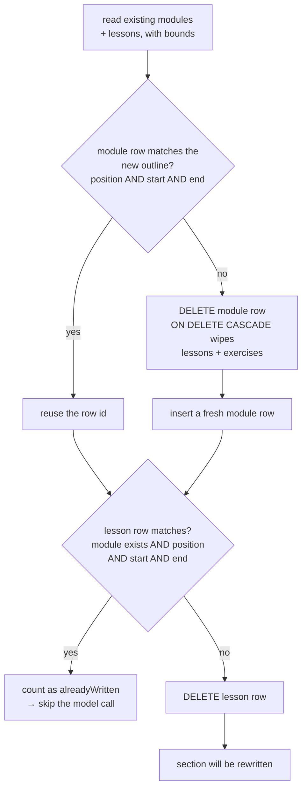
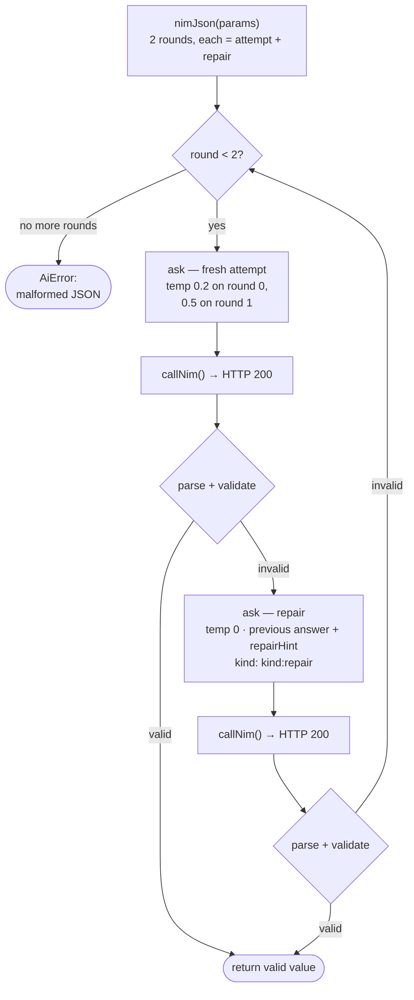
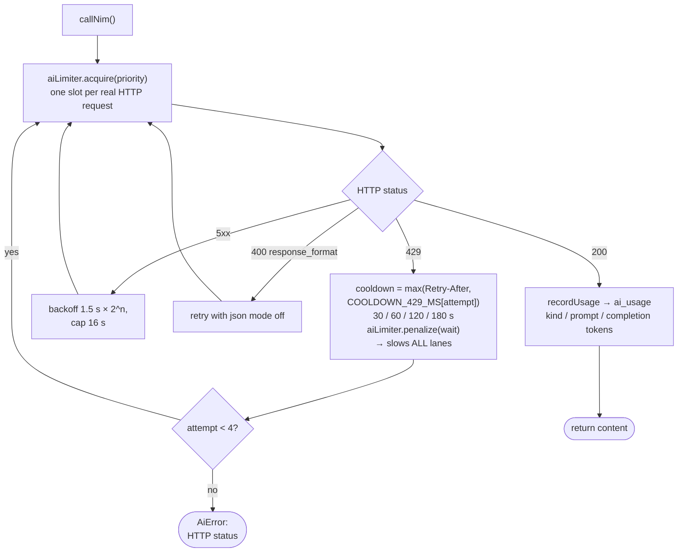

# Course build pipeline — transcript → notes

From a pasted YouTube URL to graded notes, exercises and a playable timeline.
Source of truth: `lib/ai/generate.ts` (`runCourseGeneration`), with
`lib/ai/transcript.ts`, `lib/ai/nim.ts`, `lib/ai/limiter.ts` and
`lib/ai/prompts.ts`.

The course row **is** the progress state machine — the job is fire-and-forget,
so a restart mid-build surfaces as a stale status the dashboard can retry.

```mermaid
flowchart TD
    X(["status: failed<br/>friendlyError()"])
    READY(["status: ready<br/>N modules · M sections"])

    A["createCourseAction<br/>or retryCourseAction"] --> B["startCourseJob()<br/>__freedemyJobs dedupes per course"]
    B --> C["runCourseGeneration()"]

    C --> D["status: fetching<br/>Reading the captions"]
    D --> E["loadLecture(videoId)"]
    E -->|"TranscriptError"| X
    E --> F["cues + title / channel /<br/>description / chapters"]
    F --> G["detectLanguage()<br/>duration = durationSeconds<br/>else last cue start"]

    G --> H["status: outlining<br/>Finding the structure<br/>+ title, language, duration_seconds"]
    H --> I["buildWindows(cues, duration)<br/>ceil(duration / 1200) windows<br/>hard cap 240 (~80 h)"]

    I --> J["Promise.all over windows"]
    J --> K["nimJson: MappedSegment[]<br/>kind: map · transcript ≤ 40 000 chars<br/>maxTokens 2 500"]
    K --> L{"validateSegments<br/>inside this window ± slack?"}
    L -->|"no — repair round"| K
    L -->|"yes"| M["segments[]  (flatMap)"]

    M --> N{"segments empty?"}
    N -->|"yes"| X
    N -->|"no"| O{"outline estimate<br/>≤ outlineBudget?"}

    O -->|"no — cannot fit the<br/>16 384-token cap"| P["outlineFromTopics(segments)<br/>no model call"]
    O -->|"yes"| Q["nimJson: Outline<br/>kind: outline<br/>validateOutline(duration)"]
    Q -->|"rejected / unparseable"| R["warn with the real reason<br/>→ outlineFromTopics(segments)"]
    Q -->|"valid"| S{"lessonsTooLong?"}
    P --> S
    R --> S
    S -->|"yes"| P2["outlineFromTopics(segments)"]
    S -->|"no"| T["status: writing<br/>Planning N modules"]
    P2 --> T

    T --> U["plans: one nimJson ModulePlan<br/>per module · kind: plan<br/>temp 0.35 · maxTokens 1 500<br/>failure → defaultChecks()"]
    U --> V["reconcile existing rows<br/>(resume — see below)"]

    V --> W["one job per section"]
    W --> W1["await only this module's own plan"]
    W1 --> W2["cuesBetween(lesson.start, end)<br/>±120 s fallback · ≤ 24 000 chars"]
    W2 --> W3["nimJson: GeneratedLesson<br/>kind: lesson · maxTokens 5 000<br/>validateLessonContent()"]
    W3 --> W4["persistLesson() immediately<br/>→ lessons + exercises rows"]
    W4 --> W5["stage: Writing N of M sections<br/>if aborted, sibling jobs stop writing"]
    W5 --> W7["await Promise.all(jobs)"]

    W7 --> Z{"assertCompleteCoverage()<br/>do the DB rows tile 0 → duration?"}
    Z -->|"any violation"| X
    Z -->|"tiles exactly"| READY
```



## Stage reference

| # | `courses.status` | Stage label shown in UI | What happens |
|---|---|---|---|
| 0 | `queued` | Queued | `startCourseJob` — returns immediately, job runs in background |
| 1 | `fetching` | Reading the captions | `loadLecture` → cues, metadata, chapters parsed from the description |
| 2 | `outlining` | Finding the structure | windowing → topic map → outline decision |
| 3 | `writing` | Planning N modules | per-module assessment plans start (not awaited yet) |
| 4 | `writing` | Read N of M transcript windows | progress counter during mapping |
| 5 | `writing` | Writing N of M sections | resume reconciliation, then one job per section |
| 6 | `ready` | N modules · M sections | only after the coverage gate passes |
| — | `failed` | Generation failed | any throw; `aborted = true` stops sibling jobs |

## 2 · Windowing

```text
count   = min(240, max(1, ceil(duration / 1200)))      # fixed 20-minute windows
target  = max(1200, ceil(duration / count / 60) * 60)  # rounded to whole minutes
bucket  = floor(cue.start / target)
```

Longer videos produce **more** windows, never bigger ones, so every map call
reads a transcript slice that always fits the prompt. Only past ~80 hours does
the 240-window cap stretch a window. The 254 744 s AWS lecture → **213 windows**.

## Resume reconciliation (the 128 % defect)

A retry regenerates the outline, so old rows describe a *different* timeline.
Matching by position alone spliced two outlines together — old modules 0–28
(ending at 175 809 s) were kept while new ones started at 104 050 s, and the
course still reached `ready` at **128.2 % coverage**.



## Per-call resilience (429 must slow the build, never fail it)

### 4a · JSON rounds — attempt, repair, then a whole second round



### 4b · `callNim` internals — every HTTP request



## Coverage gate — what `ready` actually asserts

`assertCompleteCoverage(admin, courseId, duration)` reads the rows **back from
the database** (not the in-memory outline) and throws `CoverageError` on any
violation:

1. module `position` is `0, 1, 2, …` with no skips
2. first module starts at `0`; each module starts exactly where the previous ended
3. each module is non-empty (`end > start`)
4. **last module ends at exactly `duration`** — no early stop, no overrun
5. every module has ≥ 4 sections when its span ≥ `4 × 90 s`
6. sections start at the module start, run consecutively, never leave the module, and tile to the module end

Any failure → `status: failed` with
*"The course sections do not tile the whole video. Try again — the outline will be rebuilt."*

## Key constants

| Constant | Value | Meaning |
|---|---|---|
| `MAX_WINDOW_SECONDS` | 1 200 | fixed 20-minute map window |
| `MAX_WINDOWS` | 240 | ~80 h defensive ceiling |
| `MIN_LESSON_SECONDS` | 90 | shortest section worth exercises |
| `LESSON_MIN_SECONDS` | 240 | density floor the model may use |
| `MIN_LESSONS_PER_MODULE` | 4 | minimum sections per module |
| `MAX_LESSONS_PER_MODULE` | 40 | one module cannot swallow the course |
| `coverageSlack(d)` | `max(180, d × 0.02)` | tolerated tail gap (2 % of runtime) |
| `outlineBudget` | `clamp(2 500 + ceil(d/240)×45, 6 000, 16 000)` | answer token budget |
| `COOLDOWN_429_MS` | 30 / 60 / 120 / 180 s | escalating pause per 429 |

## Fallback shapes

**`outlineFromTopics`** (used when the model outline cannot fit or is rejected):

```text
moduleCount = max(2, ceil(span / 3600))     # ~one module per hour
moduleSpan  = span / moduleCount
modules with no mapped topic are skipped (logged), and the last module is
extended to cover the remainder so the timeline stays contiguous
```

**`defaultChecks(lesson)`** (used when a module's assessment plan fails):
2–4 checks built from the lesson itself, so writing never blocks on planning.

## Where time goes

Mapping and writing are both `Promise.all` fan-outs bounded by the shared
`aiLimiter`, so the real ceiling is provider throughput. Under sustained 429
throttling a 70-hour course takes ~3 wall-clock hours; every absorbed 429 slows
**all** lanes instead of failing one.
